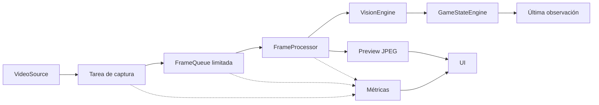

# Fase 3 — Pipeline en tiempo real

## Construido

Captura y procesamiento dejan de compartir el mismo bucle secuencial. Dos tareas asincrónicas usan executors distintos, cada uno con un thread y como máximo una operación en curso. El productor no espera a que el consumidor termine de analizar o codificar el frame anterior.



- `FrameQueue`: capacidad de 2 frames, configurable entre 1 y 8 mediante `FRAME_QUEUE_SIZE`. Al llenarse elimina el más antiguo. Al consumir devuelve el más reciente y elimina los pendientes anteriores. Nunca construye una cola adicional de tareas de procesamiento.
- `FrameProcessor`: invoca visión y prepara el JPEG fuera del event loop de FastAPI.
- `VisionEngine`: contrato inicial que describe procedencia y dimensiones del frame. No detecta mesa, cartas, apuestas ni acciones.
- `GameStateEngine`: acepta observaciones en orden estricto, conserva solo la última y un contador. Rechaza identificadores duplicados o atrasados. La reconstrucción real de `GameState` pertenece a fase 7.
- `PipelineMetrics`: tasas y latencias con relojes monotónicos y almacenamiento limitado.
- Panel desplegable **Depuración del pipeline** en `/live`, actualizado a través del estado HTTP existente de captura.

`Frame` añade `captured_at`, un tiempo monotónico interno distinto del `timestamp` de fuente. No se expone como fecha de calendario. En archivo se crea después de decodificar; en pantalla, después de recibir y decodificar el JPEG en el adaptador.

## Ciclo de vida

Al terminar el archivo, el productor cierra la entrada de la cola; el procesador termina su trabajo actual y procesa el frame pendiente más reciente. Solo se anuncia `ended` después de cerrar los workers, liberar la fuente y eliminar el archivo temporal.

Al detener manualmente, se cierra la cola y se descartan sus pendientes. Si ya había trabajo nativo en curso, se espera a que termine y se descarta su resultado, sin actualizar la observación ni publicar un preview después de la parada. El cierre también despierta a un consumidor que espera en una cola vacía.

Un error de captura o procesamiento detiene ambos lados, vacía la cola y libera recursos. Una captura nueva crea nueva cola, métricas, procesador y receptor de observaciones. Los dos modos conservan su configuración del servidor; no se incorporan recomendaciones.

## Métricas del contrato HTTP

`GET /api/capture` conserva los campos anteriores y añade `pipeline` (nulo antes de la primera captura) y `observation_state`.

| Campo de `pipeline` | Significado |
| --- | --- |
| `active` | Las tareas del pipeline están en ejecución |
| `capture_fps` | Frames que entran en la cola por segundo; no FPS originales del vídeo |
| `processing_fps` | Resultados completados y publicados por segundo |
| `window_seconds` | Ventana de tasas: 5 segundos |
| `queue_size`, `queue_capacity` | Frames pendientes y límite configurado |
| `queue_high_watermark` | Máxima ocupación observada en esta captura |
| `captured_frames`, `processed_frames` | Contadores acumulados de entrada y publicación |
| `dropped_frames` | Frames antiguos eliminados por saturación o al elegir el más reciente |
| `discarded_frames` | Pendientes y trabajo en curso descartados durante parada o error |
| `failed_frames` | Frames cuyo procesamiento o publicación falló |
| `in_flight` | Frame actualmente procesándose: 0 o 1 |
| `processing_latency_ms` | Último tiempo desde el comienzo de procesamiento hasta publicación |
| `mean_processing_latency_ms` | Media de los últimos 128 resultados publicados |
| `queue_wait_ms` | Disponibilidad del frame en backend hasta inicio de procesamiento |
| `frame_latency_ms` | Disponibilidad del frame hasta publicación; espera más procesamiento |

Los FPS se calculan sobre tiempo transcurrido, con un segundo mínimo de calentamiento. Al terminar pasan a cero, mientras los contadores y latencias se conservan. Sin frames procesados, las latencias son `null` y la interfaz muestra «—».

Las muestras de tasas se limitan a 512 marcas temporales por etapa y las latencias a 128 valores; no crecen con la duración de una sesión. Al leer métricas se eliminan marcas fuera de ventana. A los 15 FPS máximos configurables hay margen suficiente para toda la ventana de 5 segundos.

Se mantiene la relación:

`capturados = procesados + descartados antiguos + descartados al cerrar + fallidos + en cola + en proceso`

Estos contadores cubren la cola de procesamiento. No cuentan imágenes omitidas al muestrear el vídeo original ni sustituciones en el adaptador de pantalla previas a su entrada en la cola.

`observation_state` declara `recognition_available: false`, `observations_seen` y `last_frame_id`. No contiene un estado de partida inventado. El frame del preview y la última observación provienen del mismo resultado procesado.

## Archivos y ejecución

Se añaden `backend/app/pipeline_engine/`, `backend/app/vision_engine/`, `backend/app/game_state_engine/`, `backend/tests/test_pipeline.py`, `frontend/src/capture/PipelineDebug.tsx` y sus estilos. Se actualizan `CaptureEngine`, configuración, metadata de `Frame`, versión/handshake, contratos TypeScript, página en directo, portada, tests de navegador, `.env.example`, Compose y README. No se modifican los requisitos funcionales de `app.md` ni se añaden dependencias.

```powershell
docker compose up --build -d --wait
backend/.venv/Scripts/python -m pytest backend -o cache_dir=.pytest_cache_phase3
```

Con la aplicación en marcha y el vídeo de muestra generado, desde `frontend/`:

```powershell
npm run build
npm run format:check
npm test
```

Para probarlo manualmente, abre `/live`, reproduce `sample_data/capture-demo.avi` y despliega **Depuración del pipeline**. Verás las tasas reales, cola y latencias. Detén y vuelve a iniciar una fuente: los contadores se reinician. No se añade un retardo artificial a la aplicación; la sobrecarga se inyecta únicamente en pruebas.

## Validación y alcance

Se revisó la fase 2 antes de validar esta fase. Los servicios estaban detenidos; tras arrancarlos pasaron sus 15 pruebas de backend y 8 de navegador.

Las pruebas nuevas cubren productor independiente mientras el procesador está bloqueado, cola acotada, elección del frame más reciente, cierre en EOF, parada con trabajo en curso sin publicación tardía, fallos en cada worker, liberación de fuente, reinicio de contadores, respuesta HTTP durante sobrecarga y rechazo de observaciones repetidas.

Una prueba ofrece 10.000 frames y comprueba con referencias débiles que solo permanecen los dos pendientes. Otra registra 10.000 muestras y verifica los límites de almacenamiento de métricas. Son comprobaciones de estructuras acotadas, no una certificación de funcionamiento durante 8 horas.

Resultado final del 17 de septiembre de 2026: **26 pruebas de backend y 8 de navegador superadas**. Compilación de TypeScript/Vite y comprobación de formato correctas. Los tres contenedores están saludables y no aparecen errores de ejecución del pipeline en los logs de la validación final. Se revisó el panel desplegado en escritorio y móvil, con vídeo de archivo y captura nativa de una pestaña. Persisten los dos avisos de deprecación de Starlette/AnyIO de fases anteriores.

## Limitaciones y siguiente fase

La latencia no incluye el transporte navegador-servidor, decodificación anterior a la creación del `Frame` ni visualización de la UI. En pantalla, la espera puede incluir la permanencia en el adaptador antes de entrar en la cola. No equivale a la latencia total extremo a extremo.

Los threads evitan que una operación de procesamiento ocupe el worker de captura. No garantizan paralelismo de código Python intensivo bajo el GIL. Las futuras inferencias pesadas pueden requerir procesos o GPU. Un thread bloqueado permanentemente dentro de una librería nativa no se puede cancelar de forma segura; la parada normal espera su finalización.

No se detectan regiones ni se reconocen cartas o stacks. La **fase 4** añadirá un layout para una plataforma y resolución concretas y un overlay para comprobar las regiones de la mesa.

## Referencias

- [Python: ejecución con pools de threads](https://docs.python.org/3/library/asyncio-eventloop.html#executing-code-in-thread-or-process-pools).
- [Python: sincronización con asyncio.Event](https://docs.python.org/3/library/asyncio-sync.html#asyncio.Event).
